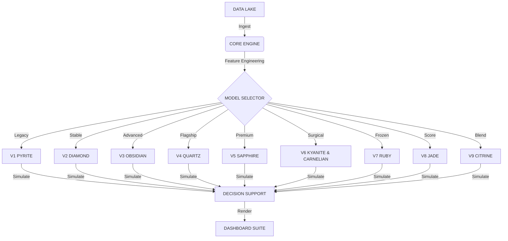

   
  <h1>QUARRY INTELLIGENCE</h1>
  
INSTITUTIONAL ALGORITHMIC ANALYTICS

   

  
  
  
  
  
  

   
   
  <a href="https://dsargent21.github.io/Quarry-Intelligence/web/selector.html"><strong>ACCESS CONTROL CENTER</strong></a>
   
   

---

## ⚡ EXECUTIVE INTELLIGENCE

A multi-generational algorithmic research system built on **gradient-boosted trees
(XGBoost)** and point-in-time feature engineering, hunting pricing inefficiencies in sports
betting markets. Every deployed number below is produced by a frozen model against data it
has never seen.

| MODEL ARCHITECTURE | RELEASED | STRATEGY PROFILE | STATUS | VOLUME | TOTAL BETS | ROI |
| :--- | :--- | :--- | :--- | :--- | :--- | :--- |
| **[SERIES 9: CITRINE](https://dsargent21.github.io/Quarry-Intelligence/web/citrine.html)** | `SEP 22, 2026` | `SKILL-GATED BLEND`   Higher-volume forward test | 🟡 **BACKTEST** | Medium (8/day) | **1126 OOS** | **+5.9% adj** |
| **[SERIES 8: JADE](https://dsargent21.github.io/Quarry-Intelligence/ledger/)** | `SEP 22, 2026` | `SCORE-OPTIMIZED`   The Quarry Ledger | 🟢 **FORWARD TEST** | Very Low (&le;5/day) | **243** | **-3.7%** |
| **[SERIES 7: RUBY](https://dsargent21.github.io/Quarry-Intelligence/web/ruby.html)** | `AUG 27, 2026` | `FROZEN POLICY`   Walk-forward edge | 🔴 **FORWARD TEST** | Medium (&le;6/day) | **340** | **+4.6%** |
| **[SERIES 6: KYANITE & CARNELIAN](https://dsargent21.github.io/Quarry-Intelligence/web/kyanite_carnelian.html)** | `MAY 16, 2026` | `SURGICAL ALPHA`   Precision/Yield | 💎 **ACTIVE** | Very High (~63 bets/day) | **8296** | **-0.8%** |
| **[SERIES 5: SAPPHIRE](https://dsargent21.github.io/Quarry-Intelligence/web/sapphire.html)** | `MAY 13, 2026` | `CONFORMAL   Momentum` | 🔵 **ACTIVE** | High (~44 bets/day) | **5946** | **-0.6%** |
| **[SERIES 4: QUARTZ](https://dsargent21.github.io/Quarry-Intelligence/web/quartz.html)** | `APR 06, 2026` | `INSTITUTIONAL   Drift Proxy` | ⚪ **ACTIVE** | Low (~5 bets/day) | **982** | **+1.9%** |
| **[SERIES 3: OBSIDIAN](https://dsargent21.github.io/Quarry-Intelligence/web/obsidian.html)** | `DEC 27, 2025` | `ADVANCED ENSEMBLE   Non-Linear` | 🟣 **ACTIVE** | Medium (~11 bets/day) | **3229** | **-9.0%** |
| **[SERIES 2: DIAMOND](https://dsargent21.github.io/Quarry-Intelligence/web/diamond.html)** | `NOV 30, 2025` | `PRECISION CORE   Refined` | 🟢 **ACTIVE** | High (~25 bets/day) | **7673** | **-10.7%** |
| **[SERIES 1: PYRITE](https://dsargent21.github.io/Quarry-Intelligence/web/pyrite.html)** | `NOV 20, 2025` | `LEGACY CORE   High-Freq` | 🟡 **ACTIVE** | Low (~6 bets/day) | **2083** | **-2.9%** |

> [!IMPORTANT]
> **ACCESS PROTOCOL**: The primary interface for all models is the [**Model Selector**](https://dsargent21.github.io/Quarry-Intelligence/web/selector.html).
>
> **STATUS SEMANTICS**: `FORWARD TEST` = live ledger, frozen model, results graded at posted
> prices. `BACKTEST` = walk-forward out-of-sample evidence only, no live picks yet.
> `ACTIVE` = simulated / historical series retained for research.

### 🟢 LIVE SCOREBOARD

Rebuilt automatically by the daily workflows from each system's ledger — never edited by hand.

<!-- QUARRY:LIVE:START -->
| SYSTEM | STATUS | GRADED | PENDING | PROFIT | ROI | LAST UPDATE |
| :--- | :--- | ---: | ---: | ---: | ---: | :--- |
| JADE (VIII) | Forward test | 199 | 44 | -7.1u | -3.7% | 2026-11-12 |
| RUBY (VII) | Forward test | 252 | 88 | +11.7u | +4.6% | 2026-11-11 |
| CITRINE (IX) | Backtest only | 0 | 0 | 0.0u | — | 2026-09-23 |
<!-- QUARRY:LIVE:END -->

---

## 🛰 SYSTEMS OVERVIEW

### V9 CITRINE // THE FORWARD DOOR
*Series IX — higher volume, same honesty.* A skill-gated blend of the shrunk capper-skill
model and the point-in-time ML ranker, capped at 8 picks a day.
*   **Protocol**: walk-forward with monthly retrains, 3-day result lag, pre-fold calibration,
    day-clustered bootstrap intervals; policy frozen before the out-of-sample window.
*   **Out-of-sample (Apr–Sep 2026)**: n=1,126, WR 56.0%, ROI +6.21%, adj **+5.92%**,
    t=+2.21, 90% CI [+1.5%, +10.4%], +70.0u.
*   **Volume**: cap 5/day scores +8.1% but is too thin to judge; 20/day collapses to +2.0%.
    8/day is the frozen sweet spot.
*   **Live tracking**: [Citrine Tracker](https://dsargent21.github.io/Quarry-Intelligence/web/citrine.html)
    — forward-first; the ledger starts at zero and only forward picks decide whether it earns trust.
*   **Read**: [SERIES 9: CITRINE Audit](docs/reports/CITRINE_REPORT.md)

### V8 JADE // THE QUARRY LEDGER
*Score-optimized selection.* Built to maximise the CappersTracked grade itself: Bayesian-shrunk,
odds-clamped scoring implemented byte-exact, ranked daily slates capped at 5 bets, flat 1u.
*   **Protocol**: anchored walk-forward with monthly retrains, fully causal early stopping and
    calibration; one pre-registered policy round, evaluated once on a frozen September 2026 holdout.
*   **Frozen holdout (Sep 2026)**: n=95, WR 58.9%, raw +11.7%, adj +7.7% → grade **A**;
    deployment-realistic under posted-odds-only selection: n=88, adj +8.9%. Single-month
    sample — the forward test decides, and it is currently running negative.
*   **Live tracking**: [The Quarry Ledger](https://dsargent21.github.io/Quarry-Intelligence/ledger/)
    — one frozen slate per day, published automatically at 18:30 Central.
*   **Read**: [SERIES 8: JADE Audit](docs/reports/JADE_REPORT.md)

### V7 RUBY // THE FROZEN POLICY TEST
*The original honest edge.* Policy frozen on a leakage-controlled walk-forward, now live-tested
with no retraining and no re-tuning.
*   **Protocol**: policy grid (216 configs) tuned only on Nov 2025–May 2026 folds; frozen
    Jun–Aug untouched. Acceptance bar: t ≥ 2, n ≥ 80, ≥ 2/3 months positive.
*   **Walk-forward result (frozen)**: n=307, ROI +11.0%, t=+2.04, +33.8u, positive 3/3 months.
*   **Universe**: Discord-sourced picks — every row whose source is *not* one of the four
    tracked public sites (Winners & Whiners, WagerTalk, SportsLine, SportsCapping).
*   **Live tracking**: [Ruby Forward Ledger](https://dsargent21.github.io/Quarry-Intelligence/web/ruby.html)
    — updated daily by the pipeline, graded at posted prices.
*   **Read**: [SERIES 7: RUBY Audit](docs/reports/RUBY_REPORT.md)

### V6 KYANITE & CARNELIAN // THE SURGICAL DNA
*Dual-engine framework* balancing high-threshold precision (Kyanite) with maximum Bayesian
value (Carnelian). Isolates institutional-grade win thresholds and high-edge underdog windows.

### V5 SAPPHIRE // THE CONFORMAL ENGINE
**Split conformal prediction** with dynamic momentum to bound risk, asymmetric loss
optimisation and drift-aware feature engineering.

### V4 QUARTZ // THE PRISM
**Correct-shift** logic identifying opening-line inefficiencies; the flagship of the
pre-forward-test era.

---

## 🔄 AUTOMATION

Two GitHub Actions workflows keep this file, the site and every ledger current. Neither one
retrains a deployed model.

| Workflow | Schedule | What it does |
| --- | --- | --- |
| **Daily Quarry Ledger** | 23:30 UTC | Jade frozen slate → grade → rebuild ledger page → refresh README → commit → Pages |
| **Daily Quarry Pipeline** | 09:00 UTC | data ingest → Ruby frozen tracker → refresh README → commit → Pages |

`scripts/update_readme_metrics.py` rewrites the model-table cells and the live scoreboard
from `docs/ruby_forward.json`, `docs/ledger/ledger_summary.json` and
`docs/web/citrine_summary.json`. It refuses to publish a ledger older than 26 hours for the
workflow that produced it, so a dead pipeline fails loudly instead of freezing numbers.

---

## 📚 KNOWLEDGE BASE

### 🔬 DEEP INTELLIGENCE REPORTS
Comprehensive technical audits and strategy profiles for the current model lineup.

*   **[SERIES 9: CITRINE Audit](docs/reports/CITRINE_REPORT.md)** - Skill-gated blend, leakage controls & the volume trade-off
*   **[SERIES 8: JADE Audit](docs/reports/JADE_REPORT.md)** - Score-optimized grading, dual channels & the frozen September holdout
*   **[SERIES 7: RUBY Audit](docs/reports/RUBY_REPORT.md)** - Frozen walk-forward results & forward-test protocol
*   **[SERIES 6: KYANITE & CARNELIAN Audit](docs/reports/KYANITE_REPORT.md)** - Surgical Alpha, Precision & Liquidity Optimization
*   **[SERIES 5: SAPPHIRE Audit](docs/reports/SAPPHIRE_REPORT.md)** - Conformal Prediction & Momentum
*   **[SERIES 4: QUARTZ Audit](docs/reports/QUARTZ_REPORT.md)** - Institutional Drift Proxy
*   **[SERIES 3: OBSIDIAN Audit](docs/reports/OBSIDIAN_REPORT.md)** - Advanced Non-Linear Ensembles
*   **[SERIES 2: DIAMOND Audit](docs/reports/DIAMOND_REPORT.md)** - Precision Core & Refined Filtering
*   **[SERIES 1: PYRITE Audit](docs/reports/PYRITE_REPORT.md)** - Legacy High-Frequency Core

### 🏛️ LEGACY ARCHIVES
Historical research, methodology versions, and experimental results.

*   **[Deep Mining Report](docs/archive/DEEP_MINING_REPORT.md)** - Foundational research on market inefficiencies.
*   **[Momentum Physics](docs/archive/MOMENTUM_PHYSICS.md)** - Theoretical basis for V5 velocity engines.
*   **[Quantum Results](docs/archive/QUANTUM_RESULTS.md)** - Experimental V4 quantum-enhanced backtests.
*   **[Stress Test Results](docs/archive/STRESS_TEST_RESULTS.md)** - Robustness analysis under extreme market drift.
*   **[Methodology V2](docs/archive/methodology_v2.md)** | **[Methodology V1](docs/archive/methodology_v1.md)**

---

## 🛠 ARCHITECTURE

---

    
<em>© 2026 QUARRY INTELLIGENCE GROUP // PROPRIETARY RESEARCH</em>

